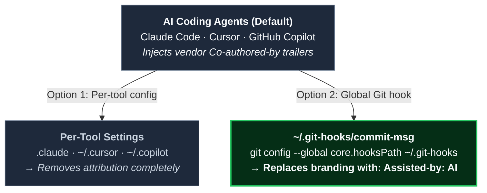

# Unbranded Commits

Reference configurations and a universal Git hook for removing vendor branding from AI-assisted commit messages.




## Contents

- **[`providers.md`](providers.md)**: Configuration flags to disable automatic commit branding per AI tool.
- **[`commit-msg`](commit-msg)**: A global Git hook that removes vendor-specific AI lines (`Co-authored-by:`, `Made-with:`, `Claude-Session:`) and replaces them with a neutral `Assisted-by: AI` line.
- **[`commit-msg-warn`](commit-msg-warn)**: A variant that stops the commit and shows the vendor lines instead of rewriting them.
- **[`INSTALL.md`](INSTALL.md)**: Install steps from a clone of this repo, a quick check, and caveats.

---

## Global Git Hook Installation

Using a global `commit-msg` hook standardizes attribution across all repositories and AI tools without requiring per-tool configuration changes.

### Setup (macOS / Linux / Git Bash)

1. Create a global hooks directory and download the script:
   ```bash
   mkdir -p ~/.git-hooks
   curl -fsSL https://raw.githubusercontent.com/AndrewJByrne/unbranded-commits/main/commit-msg -o ~/.git-hooks/commit-msg
   chmod +x ~/.git-hooks/commit-msg
   ```

2. Configure Git to use the global hooks directory:
   ```bash
   git config --global core.hooksPath ~/.git-hooks
   ```

> **Note:** Setting `core.hooksPath` globally overrides repository-level `.git/hooks`. If you use repository hook managers such as Husky or Lefthook, integrate the `commit-msg` logic into your existing hook pipeline instead.

---

## Contributing

To add a new AI tool or update a changed configuration schema, see [`CONTRIBUTING.md`](CONTRIBUTING.md).
