# End-to-End Agent Test Log & Screenshots

This document logs the exact commands, observations, and terminal screenshots from testing five CLI coding agents across three states:

1. **Factory Default ("Before"):** What each agent writes to `git log` out of the box.
2. **Provider Setting Override:** Disabling attribution using each vendor's native config file.
3. **Global `commit-msg` Hook:** Running each agent on factory defaults with `~/.git-hooks/commit-msg` active.

---

## Test Environment Setup

All five CLI coding agents were installed on Ubuntu Linux and tested inside an isolated Git sandbox (`/tmp/demo-repo`) initialized with a baseline `chore: initial commit`.

```bash
for cmd in claude agent copilot codex agy; do
  printf "%-8s -> " "\$cmd"
  \$cmd --version 2>/dev/null | head -n 1
done
```

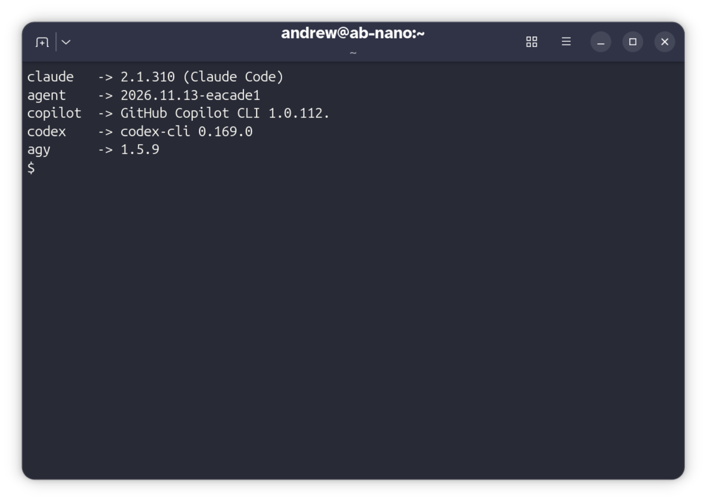

---

## 1. Claude Code (`claude`)

### Stage 1: Factory Default
* **Command:**
  ```bash
  echo "console.log('v1');" > app.js
  claude -p "stage app.js and commit this change"
  ```
* **Observation:** Out of the box, Claude Code appends `Co-Authored-By: Claude Haiku 5.5 <noreply@anthropic.com>` to the commit message.
* **Screenshot:**
  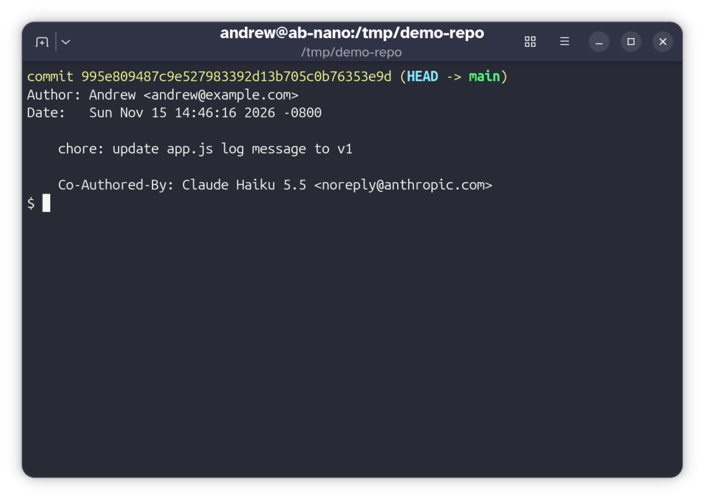

### Stage 2: Provider Setting Override
* **Config (`.claude/settings.json` or `~/.claude/settings.json`):**
  ```json
  {
    "attribution": {
      "commit": "",
      "pr": "",
      "sessionUrl": false
    }
  }
  ```
* **Command:**
  ```bash
  echo "console.log('v2');" > app.js
  claude -p "stage app.js and commit this change"
  ```
* **Observation:** Setting `"commit": ""` removes the trailer completely, leaving zero indication that AI assisted on the commit.
* **Screenshot:**
  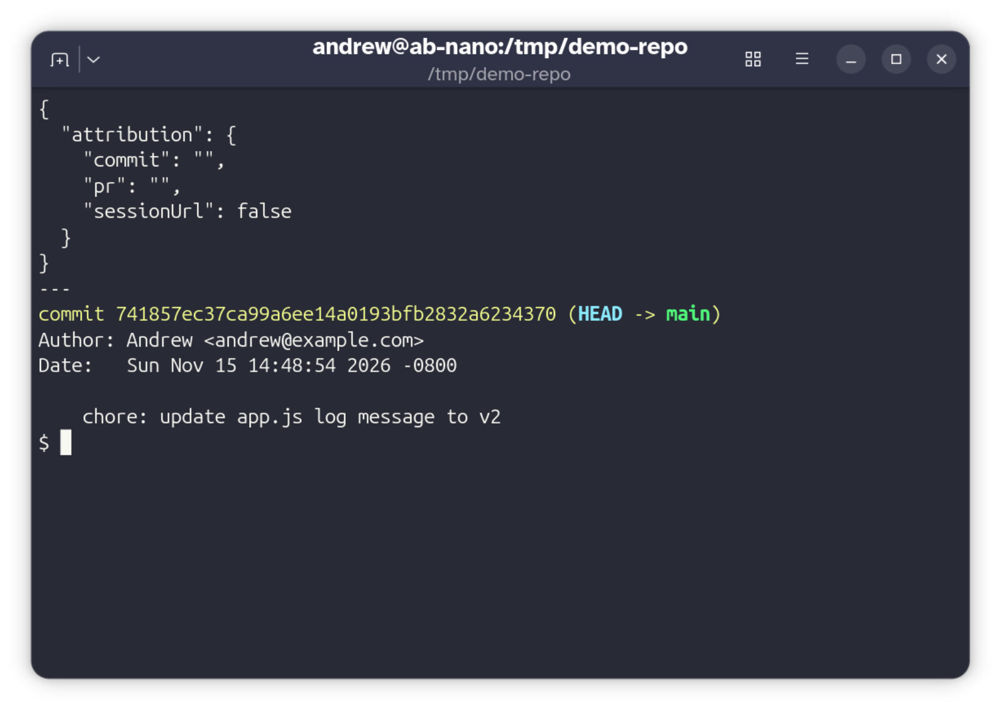

### Stage 3: With Global `commit-msg` Hook Active
* **Command (with `.claude/settings.json` removed):**
  ```bash
  echo "console.log('v1');" > app.js
  claude -p "stage app.js and commit this change"
  ```
* **Observation:** The hook strips Anthropic's `Co-Authored-By:` line and appends `Assisted-by: AI`.
* **Screenshot:**
  

---

## 2. Cursor CLI (`agent`)

### Stage 1: Factory Default
* **Command:**
  ```bash
  echo "console.log('v1');" > app.js
  agent -p -f "stage app.js and commit this change"
  ```
* **Observation:** On first login, Cursor CLI automatically generates `~/.cursor/cli-config.json` with `"attributeCommitsToAgent": true` and injects `Co-authored-by: Cursor <cursoragent@cursor.com>`.
* **Screenshot:**
  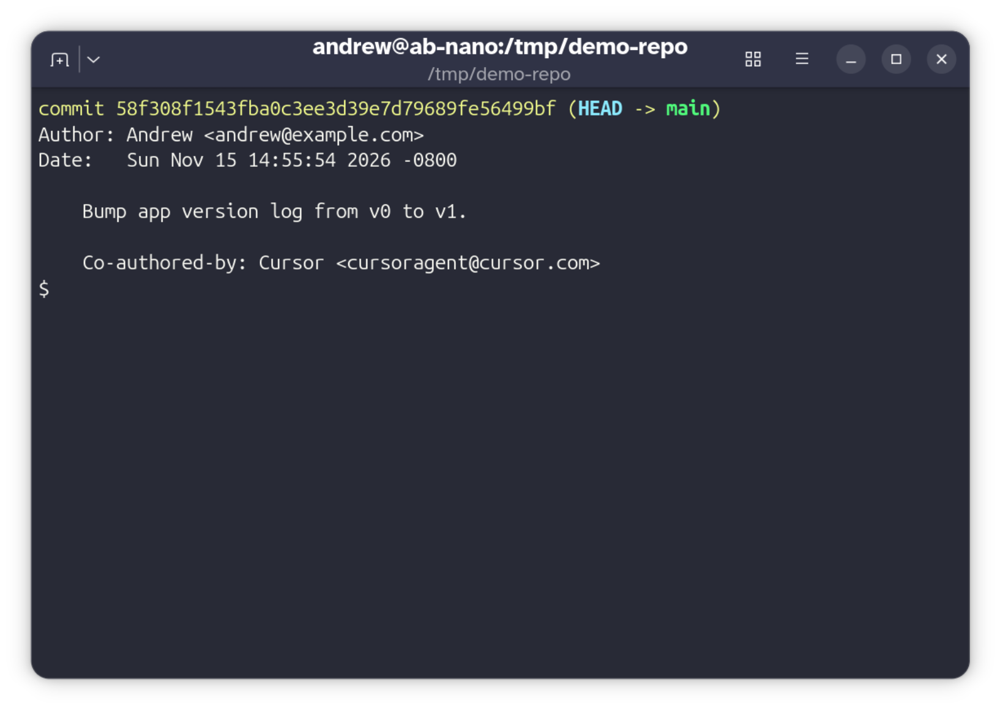

### Stage 2: Provider Setting Override
* **Config (`~/.cursor/cli-config.json`):**
  ```json
  "attribution": {
    "attributeCommitsToAgent": false,
    "attributePRsToAgent": true
  }
  ```
* **Command:**
  ```bash
  echo "console.log('v2');" > app.js
  agent -p -f "stage app.js and commit this change"
  ```
* **Observation:** Flipping `attributeCommitsToAgent` to `false` stops Cursor CLI from adding any trailer.
* **Screenshot:**
  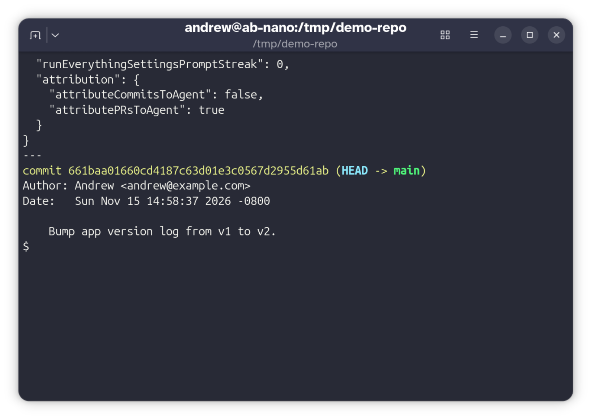

### Stage 3: With Global `commit-msg` Hook Active
* **Command (with `"attributeCommitsToAgent": true` restored):**
  ```bash
  echo "console.log('v2');" > app.js
  agent -p -f "stage app.js and commit this change"
  ```
* **Observation:** The hook intercepts `Co-authored-by: Cursor` and replaces it with `Assisted-by: AI`.
* **Screenshot:**
  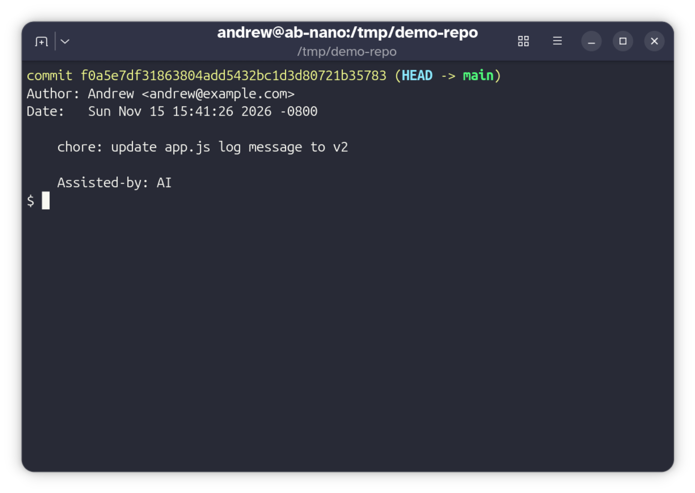

---

## 3. GitHub Copilot CLI (`copilot`)

### Stage 1: Factory Default
* **Command:**
  ```bash
  echo "console.log('v1');" > app.js
  copilot -p "stage app.js and commit this change" --allow-all-tools
  ```
* **Observation:** Copilot CLI explicitly passes `-m "Co-authored-by: Copilot <223556219+Copilot@://github.com>"` to `git commit` by default.
* **Screenshot:**
  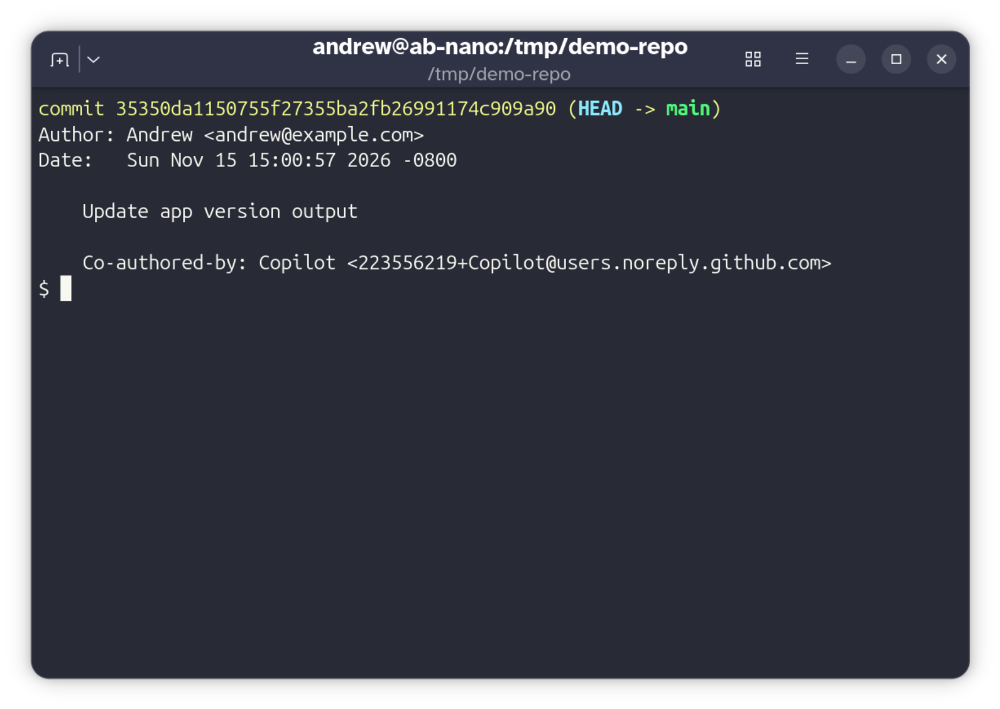

### Stage 2: Provider Setting Override
* **Config (`~/.copilot/settings.json`):**
  ```json
  {
    "includeCoAuthoredBy": false
  }
  ```
* **Command:**
  ```bash
  echo "console.log('v2');" > app.js
  copilot -p "stage app.js and commit this change" --allow-all-tools
  ```
* **Observation:** Creating `~/.copilot/settings.json` with `"includeCoAuthoredBy": false` suppresses the trailer completely.
* **Screenshot:**
  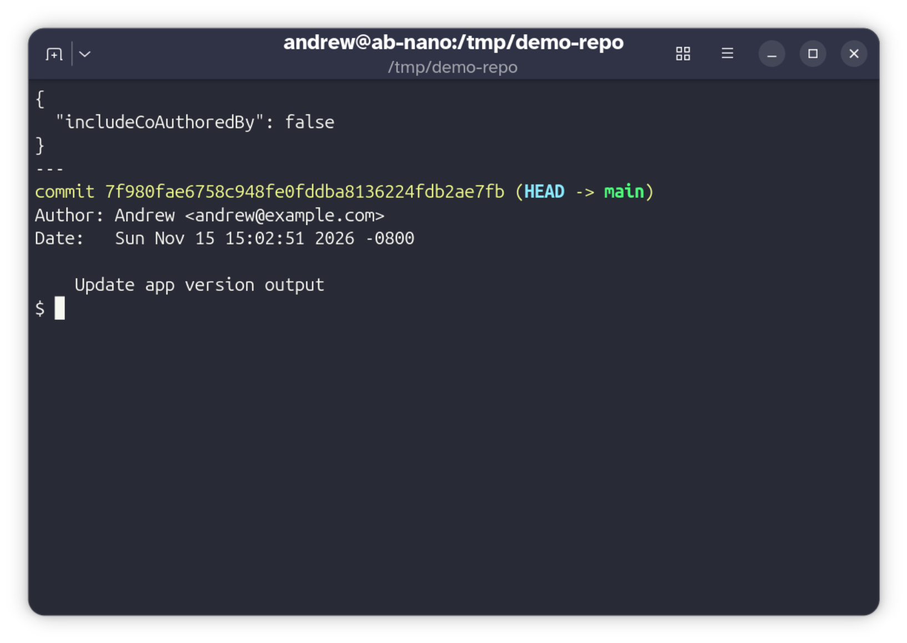

### Stage 3: With Global `commit-msg` Hook Active
* **Command (with `~/.copilot/settings.json` removed):**
  ```bash
  echo "console.log('v3');" > app.js
  copilot -p "stage app.js and commit this change" --allow-all-tools
  ```
* **Observation:** Even when Copilot CLI passes `-m "Co-authored-by: Copilot..."` directly on the `git commit` command line, the `commit-msg` hook strips it in flight and writes `Assisted-by: AI`.
* **Screenshot:**
  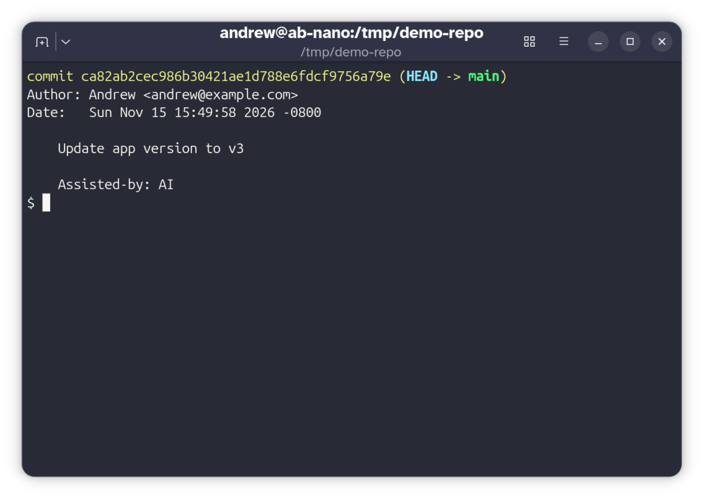

---

## 4. OpenAI Codex CLI (`codex`)

### Factory Default
* **Command:**
  ```bash
  echo "console.log('v1');" > app.js
  codex exec --dangerously-bypass-approvals-and-sandbox "stage app.js and commit this change"
  ```
* **Observation:** Codex CLI leaves commit messages completely unbranded out of the box. Attribution is strictly opt-in via `commit_attribution` in `~/.codex/config.toml`.
* **Screenshot:**
  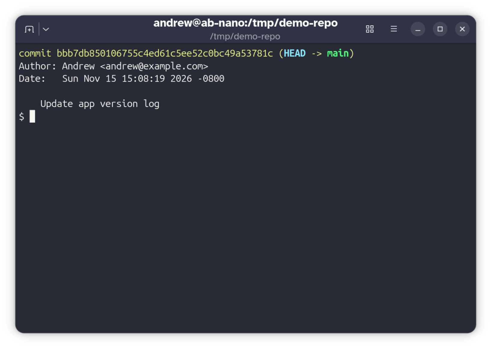

---

## 5. Antigravity (`agy`)

### Factory Default
* **Command:**
  ```bash
  echo "console.log('v1');" > app.js
  agy -i "stage app.js and commit this change"
  ```
* **Observation:** Antigravity leaves commit messages completely unbranded out of the box. (Note: In headless `-p` mode, Antigravity respects `permissions.allow` in `~/.gemini/antigravity/settings.json` and prompts before executing mutating `git commit` commands.)
* **Screenshot:**
  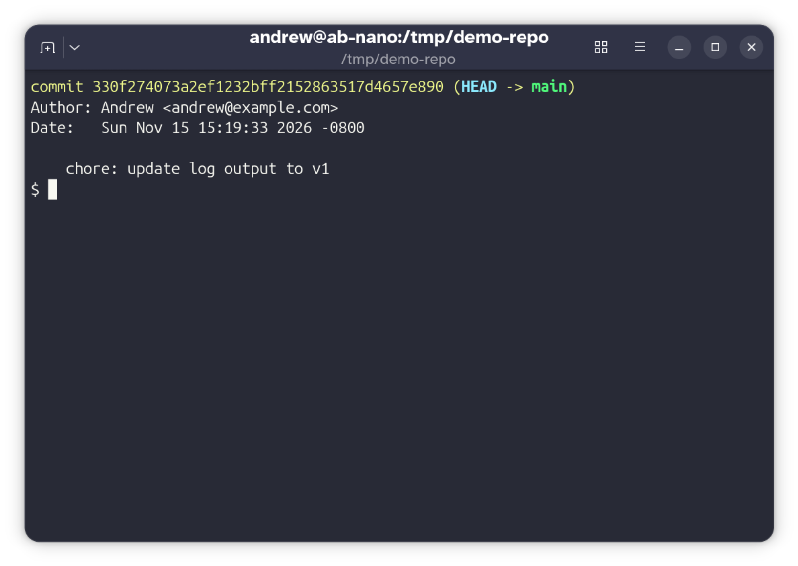

---

## Composite Result: All Three Branding Agents Standardized

With `core.hooksPath` pointing to `~/.git-hooks/commit-msg` and all three branding agents (`claude`, `agent`, `copilot`) running at factory defaults, every commit in the repository ends with the same vendor-neutral `Assisted-by: AI` trailer:

```bash
git log -3 --reverse --format="%h  %s%n    %(trailers:only)"
```

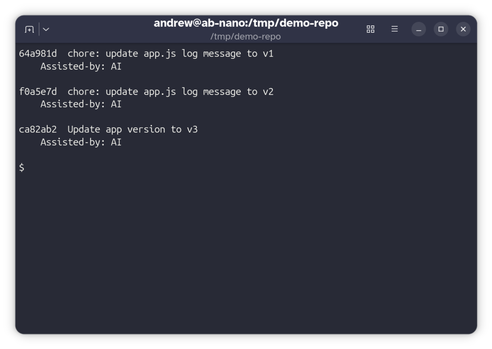
